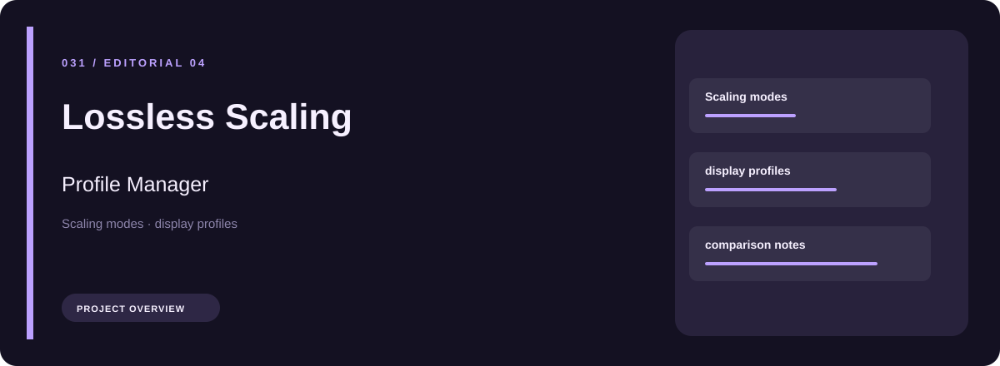
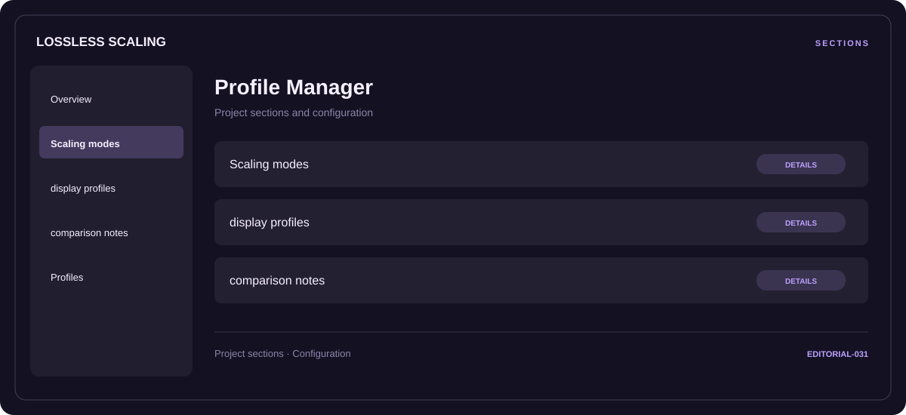

# 🧭 Lossless Scaling Profile Manager

**Scaling modes · Display profiles · Comparison notes**

## ⚡ Features

Lossless Scaling Profile Manager groups scaling modes, display profiles, and comparison notes in a single workspace. Each section keeps its controls and related settings together.

### ⚙️ Scaling modes

Content and resource groups, together with their configuration or organization details.

### 🧩 Display profiles

Related settings collected into named groups for a clearer configuration workflow.

### ⌨️ Comparison notes

A dedicated section for comparison notes and the configuration details associated with that area.

## 🖥️ Project navigation

## 📥 Download

The button and cover open the project's download page. Use the information supplied with the downloaded package for installation and release-specific requirements.

## 📚 Project documentation

- [Feature reference](docs/FEATURES.md)
- [Download information](docs/DOWNLOAD.md)
- [Project page](index.html)

---

Lossless Scaling Profile Manager · Program documentation and download information.
